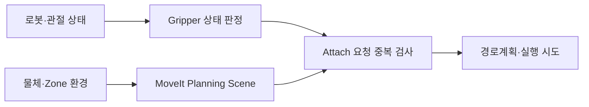

# Robotics × AI — 실물 로봇부터 검증 가능한 코드까지

**서울대학교 기계공학부 | 개인 기술 포트폴리오**

2022년에는 로봇의 바퀴와 집게를 직접 만들고 시험했습니다. 이후 온라인 로봇 제어, ROS 2·MoveIt 2 시스템 통합, G1 강화학습 실습, AI 지원 개발로 경험을 넓혀 왔습니다. 아직 배울 것이 많지만, 무엇이 작동하지 않았고 무엇을 고쳐 보았는지 **실제 코드·설정·시험 기록**을 남기려 합니다.

> **자료 공개 범위:** 이 저장소에는 외부 배포가 가능한 기술 설명·개인 AI 지원 개발 코드·익명화된 실습 예제만 담았습니다. 동아리 소유 사진·영상·원본 코드 중 재게시 권한을 확인하지 못한 것은 포함하지 않았습니다. 실제 로봇 영상·제작 사진·학업 자료는 별도의 **교수·CTO 제한 열람용 Notion**에 보존합니다. 이 GitHub 자체에는 접근권한이 필요한 링크를 걸어 놓지 않았습니다.

---

## 01. 대표 기술 프로젝트

| 프로젝트 | 실제로 다뤄 본 문제 | 바로 확인할 근거 |
|---|---|---|
| **[Unitree G1 · 강화학습 실습](projects/g1.md)** | Isaac Lab·RSL-RL, Flat/Rough 보상 조정, 모델 입력·출력, 실패한 sim-to-sim | [실습 설정 수치](evidence/g1/flat-settings.yaml) · [실제 보상 수정 비교](projects/g1.md) |
| **[Humanoid Challenge · ROS 2 통합](projects/robotics-integration.md)** | MoveIt CollisionObject, 이미 닫힌 그리퍼의 attach 누락, TRAC-IK·TF 문제 | [환경·작업공간 시험 근거](code/robotics/ENVIRONMENT_AND_TEST_EVIDENCE.md) · [상태 처리 설명](code/robotics/README.md) |
| **[Personal AI · AI와 함께 개발하는 학습](projects/personal-ai.md)** | 요구 정의, AI 지원 구현의 검증, 제한된 실제 업무 시험과 실패, 중단 판단 | [실제 JavaScript 판정기](code/personal-ai/src/lived-canary-evidence.js) · [CLI](code/personal-ai/scripts/validate-lived-canary-evidence.mjs) · [7개 합성 테스트](scripts/check-evidence.mjs) |

### G1 — 어떤 보상을 바꾸려 했는가?

보존된 Rough 실습 설정의 수정 후보에는 아래 변화가 남아 있습니다. **파일에 기록된 값과 실제 학습에 적용된 값을 구별**합니다. 한 후보에서는 `__post_init__`가 클래스 밖에 정의돼 있어 적용 여부를 단정할 수 없습니다.

| 항목 | 기본 파일 | 수정 후보 |
|---|---:|---:|
| 발 체공 보상 `feet_air_time` | 0.25 | 0.75 |
| 토크 페널티 | −1.5e−7 | −5e−8 |
| 행동 변화 페널티 | −0.005 | −0.001 |
| 자세 기울기 페널티 | −1.0 | −0.5 |

별도 Flat 수정본에서는 오히려 과도하게 발을 드는 걸음을 억제하려고 발 체공 가중치를 **0.75 → 0.2**로 낮췄습니다. [수정 의도·실행 환경·관측/행동 분석](projects/g1.md).

### Humanoid Challenge — 모듈들이 같은 상태를 보고 있는가?



2026년 5~6월에는 **환경의 충돌 모델, 닫힌 그리퍼의 현재 상태, ROS 2 토픽, IK 플러그인, 좌표계**가 서로 다르게 동작할 때의 문제를 다뤘습니다. TRAC-IK 의존성 복구 뒤 mock planning이 **0/47 → 42/47**로 바뀐 기록이 있습니다. 이것은 실물 grasp 성공률이 아닙니다.

당시 팀 코드를 일부 수정한 기록과 AI Worker 실물의 물체 파지·너트 운반 **팀 공동 시험 경험**은 별개로 설명합니다. 팀 소유 patch 전체는 공개 권한이 확인될 때까지 싣지 않았습니다. [구체적 시행착오·기술 근거](projects/robotics-integration.md).

### Personal AI — 무엇을 믿고, 무엇을 중단했는가?

아직 완성된 자율 비서가 아닙니다. AI에게 구현을 맡기고, **사용할 수 있는지와 결과를 믿어도 되는지를 배우며 남긴 기록**입니다.

- 기존 학업 Task의 마감일만 수정하고 나머지 필드를 보존하도록 요구한 제한적 시험. 후속 권한 검토로 쓰기 기능을 중단했습니다.
- AI 워커의 `PASS`가 실제 완료를 뜻하지 않는다는 문제를 다룬 **[검증 모듈](code/personal-ai/src/lived-canary-evidence.js)**.
- 기술적으로 작동해도 사용자의 조작이 줄지 않는 개발 도구를 기본 경로에서 제외한 판단.

**실행 가능한 코드**는 아래와 같습니다.

```bash
node scripts/check-evidence.mjs
cd code/personal-ai
npm run validate
```

첫 명령은 **합성 시나리오 7개**를 검사합니다. 공개 예제에는 실제 Provider 재조회 기능이 없어, 실사용 결과로 표시한 입력은 `INVALID`로 거부합니다. 합성 코드의 통과를 실제 업무 성과로 꾸미지 않습니다. [입력·판정 기준과 실제 사용 경험](projects/personal-ai.md).

---

## 02. 실제 제작·교육·온라인 로봇

| 활동 | 실제 수행 / 의미 있는 흔적 | 상세 기록 |
|---|---|---|
| **RoboCon 2022** | 20mm 단차 실패 후 바퀴 마찰 조정, 500g 물체에서 MDF→PVC 팔 재설계, 버킷 전달 반동 해결을 위한 팀 시험 | [날짜별 제작·시험](projects/robocon.md) |
| **IDC RoboCon 2023** | Ubuntu·ROS 2 온라인 로봇 조작, Gazebo·제어 패키지와 경기 실행 환경 조사 | [제공 스크립트·참가 경험](projects/idc2023.md) |
| **SO-101 교육 TA** | 실제 장비 연결·교육자료 준비. **RL → 시연 데이터 → ACT/Diffusion IL → Hugging Face/LeRobot** 교육 지원은 향후 계획 | [완료 범위와 교육 계획](projects/so101.md) |
| **SHAPE 운영·행사팀장** | G1·SO-101·OMY·K1의 운용 학습과 행사·시연 협업을 진행 중 | [역할·진행 기록](experience.md) |

실물 사진과 교육자료 원본은 존재하지만, **팀의 공개 권한이 확인되지 않은 미디어를 이 저장소에 복제하지 않았습니다.** 그 대신 제작 시험의 날짜·문제·수정 근거를 기술 문서에 남겼습니다.

---

## 03. 2022–2026 · 배움의 과정

| 시기 | 경험 |
|---|---|
| **2022** | 수학 학원 보조·학습관리, RoboCon 구조 설계·제작·시험 |
| **2023** | SAM 수학 멘토링, IDC 온라인 로봇 조작, AI·개발 분야 탐색 |
| **2024–2025** | 수학 수업, 군 복무 중 원격 학업 지속 |
| **2026** | G1 보행 학습, Humanoid Challenge 통합, SO-101 교육 TA, Personal AI 개발·검증, SHAPE 행사 운영 |

수학 교육·멘토링·팀 협업과 그 밖의 활동을 [전체 경험 기록](experience.md)에 정리했습니다. 직접 만든 것, 팀과 함께한 것, AI가 구현한 것, 앞으로 시도하려는 것을 구분합니다.

---

## 검증과 출처

- **[실제 코드·실험의 증거 등급](docs/SOURCE_AND_SCOPE.md)** — 설정값·mock 시험·실물 경험·합성 테스트의 차이
- **[직접 실행 가능한 7개 회귀 시나리오](scripts/check-evidence.mjs)** — 실제 외부 서비스 호출 없음
- **[로컬 Markdown 파일 링크 검사](scripts/check-links.mjs)** — 외부 사이트·권한 검사는 별개

**Contact:** [GitHub @shan1343](https://github.com/shan1343)

*이 저장소는 개인 기술 학습·협업 경험의 공개 가능한 부분만 담습니다. 비공개 팀 원본·의료 데이터·개인 성적표·계정 정보를 포함하지 않습니다.*
