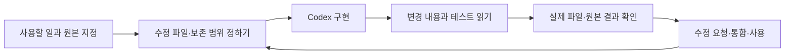

# Codex · 요구를 설명하고 구현을 확인하며 배운 개발

[첫 화면](../README.md) · [Personal AI](personal-ai.md) · [원본 파일별 근거](../code/personal-ai/CLI_AND_SKILLS_EVIDENCE.md)

**2026년 9–10월 · Personal AI 개발, 에이전트 코딩 학습, Skills·Plugins 구성과 검토**

Personal AI를 만들며 Codex를 주된 개발 도구로 사용했습니다. 원하는 기능을 설명하는 것에서 시작해, 어떤 자료를 읽고 어떤 파일을 바꿔야 하는지, 기존 기록은 무엇을 보존해야 하는지까지 작업 지시를 구체화했습니다. 구현 방법을 모두 아는 상태는 아니어서 코드 변경과 실행 결과를 읽고, 이해되지 않거나 실제 사용에 맞지 않는 부분을 다시 물으며 수정했습니다.

한 달 동안 자료 정리와 대화의 연결 방식, 로컬 실행, Wiki, 학업용 Skill 패키지를 차례로 다뤘습니다. 설치가 된 뒤에도 호출 경로가 맞지 않거나 테스트와 실제 결과가 달라 다시 확인해야 했습니다. 그 과정의 원본 파일과 시험 기록을 아래에 연결합니다.

## 요구에서 확인까지



예를 들어 학업 일정 실험에서는 공식 마감이 바뀌어도 기존 Task의 실행 시각·우선순위·상태·메모가 유지돼야 했습니다. 새 Task를 무조건 만드는 방식 대신 기존 대상을 찾아 마감만 바꾸고 다시 읽도록 요구했습니다. 제한된 시험 기록 이후 넓은 쓰기 권한과 미완료 경로를 검토해 해당 자동 쓰기는 중단했습니다. 당시 성공 보고 하나를 현재 상시 운영 상태로 취급하지 않았습니다.

## 실제로 겪은 오류와 확인 방법

| 작업 | 막힌 지점 | 수정·확인 과정 |
|---|---|---|
| Windows Wiki hook | JSON 파싱 오류, Unix식 Python 호출, CP949 출력 오류 | UTF-8 파일과 Windows 호출 경로를 검토하고 Python UTF-8 모드 적용 후 새 프로세스에서 확인 |
| Wiki의 프로젝트 범위 | 다른 저장소의 실행 기록까지 수집할 가능성 | `.wiki/_index.md`가 있는 경우에만 로컬 수집. 해당 표식이 없는 저장소에서 쓰기가 없는지 확인 |
| PowerShell Runner | stderr의 진행 문구를 실행 실패로 오해 | `$LASTEXITCODE`로 종료 상태 판정, `finally`에서 디렉터리·오류 설정 복원 |
| AI 작업자의 완료 보고 | 테스트가 통과했지만 diff가 없거나 실제 대상이 다름 | 변경 파일·검증 revision·외부 원본을 따로 확인하고 실패 기록 유지 |
| 같은 내용을 반복 지시 | 새 대화나 다른 도구에서 절차를 다시 설명해야 함 | 재사용할 절차를 Skill로 패키징하고 직접 Markdown 지시와 비교 |
| 학업용 Skill | 짧은 질문에도 긴 수업 절차를 강제하거나 설명만으로 학습 완료 처리 | 직접 답변·힌트·풀이·대화식 복습을 나누고 실제 학습자 답변을 완료 기준에 포함 |

Windows hook의 파일 재작성과 프로세스 재시작은 함께 수행됐습니다. 따라서 최초 파싱 오류를 BOM 하나의 문제로 확정하지 않았습니다. 당시 재시작 후 동작과 관련 파일의 범위가 확인된 사례로 기록했습니다.

## 원본 커밋에서 확인한 수정

설치 이후에도 발견·실행·종료 판정에서 문제가 생겼습니다. 다음은 당시 Git 변경에서 선별한 예입니다. 커밋의 날짜와 변경 내용을 확인했으며 개인 경로·계정 데이터는 옮기지 않았습니다. 요구와 수정 방향을 정하고 Codex 등 AI의 구현 결과를 검토한 개발 기록입니다.

| 날짜 · 원본 커밋 | 문제 | 실제 변경 |
|---|---|---|
| 9/20 · `587b6f9ff4a275598f52aa6704e851b57c56c4d5` | git의 정상 진행 문구가 stderr로 나와 Windows Runner가 중단 | 외부 명령 실행 중 오류 설정을 완화하고 종료 코드로 판정, `finally`에서 이전 설정 복원 |
| 9/26 · `3cad0a3d4bf9813f4f5f6d1a4061da0b2d15a434` | 플러그인이 Skill 경로를 명시하지 않음 | 플러그인 설정에 `"skills": "./skills/"` 추가 |
| 9/26 · `2427118cfec55ebcd1cb2cc2da14d86bb3207f46` | Windows에서 Python 기반 hook 호출의 이식성 문제 | 두 lifecycle hook의 호출을 Node 스크립트로 변경 |

마지막 변경의 원본 발췌입니다.

```diff
- "command": "python3 ${PLUGIN_ROOT}/hooks/session_start.py"
+ "command": "node ${PLUGIN_ROOT}/hooks/session_start.mjs"
- "command": "python3 ${PLUGIN_ROOT}/hooks/subagent_stop.py"
+ "command": "node ${PLUGIN_ROOT}/hooks/subagent_stop.mjs"
```

이 SHA들은 비공개 개발 원본의 식별자입니다. 외부에서 해당 커밋을 직접 열 수는 없으며, 위 내용은 선별한 변경 발췌입니다. 당시 lifecycle 플러그인은 개발 과정의 기록이고 현재 공개한 Academic Loop 패키지와는 다릅니다. 공개 포트폴리오 자체의 게시 커밋 날짜를 과거 개발 날짜로 바꾸지 않습니다.

## Skill을 쓰는 것에서 직접 만드는 것으로

Skill의 발견 조건은 메타데이터에, 실제 절차는 본문에, 긴 공통 규칙은 참조 문서에 두는 구성을 비교했습니다. 외부 Skill Forge를 검토한 뒤 기존 Agent Skills 구조와 평가 방식을 활용하는 쪽을 택했습니다. 새로운 평가 런타임을 하나 더 설치하지 않아도 확인할 수 있는 부분부터 시험했습니다.

9월의 제한된 비교에서는 같은 입력과 판정 기준으로 직접 Markdown 지시와 native Skill을 비교했습니다. Codex·Antigravity의 control/treatment 네 경로가 확인됐고, 당시 집계에는 보호 파일 쓰기와 잘못된 완료가 없었습니다. 이는 그 fixture에서 절차 전달이 작동한 근거이며 모든 도구의 성능·속도 개선을 측정한 결과는 아닙니다.

이후 [Academic Loop의 실제 패키지](../code/personal-ai/academic-loop/README.md)를 수업 처리·복습·과제·시험의 네 Skill로 나눴습니다. 기존 자료 재사용, 원문 용어 보존, 학습 상태의 기록 기준, 도구가 없을 때 가능한 작업을 참조 문서에 정리했습니다. Discovery Dam에서는 조사 요청의 도구 선택과 원자료 보존을 Skill로, URL·중복·기준 버전 처리를 규칙에 따라 처리하는 스크립트로 나누었습니다.

## 공개한 파일에서 확인하기

| 자료 | 원본에서 가져온 내용 | 공개 검사의 범위 |
|---|---|---|
| [Academic Loop](../code/personal-ai/academic-loop/README.md) | 플러그인 설정, 네 Skill, 공통 참조와 agent 설정 | 패키지 구조와 지침 내용 |
| [Discovery Dam 코드](../code/personal-ai/discovery-dam/README.md) | URL·중복·후보·피드백 정리 원본 | 합성 후보의 일곱 테스트 |
| [PowerShell 함수](../code/personal-ai/examples/README.md) | 작업 본문·완료 조건 파싱, 경로 선택, 외부 명령 실행 | 로컬 프로세스·문자열 검사 |
| [JavaScript 판정기](../code/personal-ai/README.md) | 보고 결과·필수 조건·부작용 대조 | 합성 입력 7개, 외부 호출 없음 |
| [Wiki 조회 기록](../evidence/personal-ai/academic-reuse.json) | 푸리에 계산의 주기·짝홀성·직교성 점검을 기존 글에서 조회 | 이전 기록의 실제 재사용 |

저장소 루트에서 PowerShell 함수를 검사합니다.

```powershell
powershell -NoProfile -ExecutionPolicy Bypass -File .\code\personal-ai\examples\test-verified-cli-helpers.ps1
```

## 제가 계속 맡은 일

원하는 사용 방식을 정하고, AI가 만든 결과를 실제 자료·환경에 연결해 확인했습니다. 오류가 생기면 입력과 변경 범위를 좁히고 다시 시험했으며, 복잡해져 쓰기 어려운 경로는 걷어냈습니다. 이 작업에는 요구 작성, 구조 이해, 반복적인 수정 요청, 실행 결과 검토와 문서화가 함께 들어갔습니다. 코드 구현에 AI의 도움을 받았다는 사실과 제가 계속 판단하고 확인한 역할을 모두 기록했습니다.
