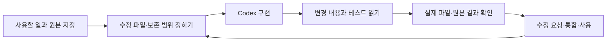

# Codex를 활용한 Personal AI 개발

[첫 화면](../README.md) · [Personal AI](personal-ai.md) · [개발 자료](../code/personal-ai/CLI_AND_SKILLS_EVIDENCE.md)

**2026년 9–10월 · Personal AI 개발, 에이전트 코딩 학습, Skills·Plugins 구성과 검토**

Personal AI 개발에는 주로 Codex를 사용했습니다. 처음에는 원하는 기능을 설명했고, 작업을 진행하면서 읽을 자료와 수정할 파일, 보존할 기록과 완료 조건까지 지시에 넣었습니다. 생성된 코드를 읽고 실행하며 이해되지 않는 부분을 물었고, 실제 사용과 맞지 않는 동작은 수정하도록 요청했습니다.

한 달 동안 자료 정리와 대화의 연결 방식, 로컬 실행, Wiki와 학업용 Skill 패키지를 다뤘습니다. 설치가 끝나도 호출 경로가 맞지 않았고, 테스트가 통과했는데 실제 파일에는 변경이 없는 경우도 있었습니다. 오류를 추적하고 변경 내용을 다시 읽는 일이 개발 과정의 상당 부분을 차지했습니다.

## 작업 방식



학업 일정 실험에서는 과제 마감만 바꾸고 기존 Task의 실행 시각·우선순위·상태·메모는 유지해야 했습니다. 기존 대상을 찾아 필요한 값만 수정한 뒤 결과를 다시 읽도록 요구했습니다. 일부 시험 이후 쓰기 권한이 넓고 미완료 경로가 남아 있어 자동 쓰기는 중단했습니다. 현재 상시 운영하는 기능은 아닙니다.

## 오류와 수정

| 작업 | 막힌 지점 | 수정·확인 과정 |
|---|---|---|
| Windows Wiki hook | JSON 파싱 오류, Unix식 Python 호출, CP949 출력 오류 | UTF-8 파일과 Windows 호출 경로를 검토하고 Python UTF-8 모드 적용 후 새 프로세스에서 확인 |
| Wiki의 프로젝트 범위 | 다른 저장소의 실행 기록까지 수집할 가능성 | `.wiki/_index.md`가 있는 경우에만 로컬 수집. 해당 표식이 없는 저장소에서 쓰기가 없는지 확인 |
| PowerShell Runner | stderr의 진행 문구를 실행 실패로 오해 | `$LASTEXITCODE`로 종료 상태 판정, `finally`에서 디렉터리·오류 설정 복원 |
| AI 작업자의 완료 보고 | 테스트가 통과했지만 diff가 없거나 실제 대상이 다름 | 변경 파일·검증 revision·외부 원본을 따로 확인하고 실패 기록 유지 |
| 같은 내용을 반복 지시 | 새 대화나 다른 도구에서 절차를 다시 설명해야 함 | 재사용할 절차를 Skill로 패키징하고 직접 Markdown 지시와 비교 |
| 학업용 Skill | 짧은 질문에도 긴 수업 절차를 강제하거나 설명만으로 학습 완료 처리 | 직접 답변·힌트·풀이·대화식 복습을 나누고 실제 학습자 답변을 완료 기준에 포함 |

Windows hook은 파일을 다시 작성하고 프로세스를 재시작한 뒤 동작했습니다. 두 조치를 함께 수행했으므로 최초 파싱 오류의 원인을 BOM으로 단정할 수는 없습니다.

## 변경 기록

Skill을 찾지 못하거나 Windows에서 hook이 실행되지 않는 문제를 고쳤습니다. 아래는 당시 비공개 개발 저장소의 커밋에서 선별한 변경입니다. 개인 경로와 계정 데이터는 제외했습니다.

| 날짜 · 원본 커밋 | 문제 | 실제 변경 |
|---|---|---|
| 9/20 · `587b6f9ff4a275598f52aa6704e851b57c56c4d5` | git의 정상 진행 문구가 stderr로 나와 Windows Runner가 중단 | 외부 명령 실행 중 오류 설정을 완화하고 종료 코드로 판정, `finally`에서 이전 설정 복원 |
| 9/26 · `3cad0a3d4bf9813f4f5f6d1a4061da0b2d15a434` | 플러그인이 Skill 경로를 명시하지 않음 | 플러그인 설정에 `"skills": "./skills/"` 추가 |
| 9/26 · `2427118cfec55ebcd1cb2cc2da14d86bb3207f46` | Windows에서 Python 기반 hook 호출의 이식성 문제 | 두 lifecycle hook의 호출을 Node 스크립트로 변경 |

마지막 변경의 원본 발췌입니다.

```diff
- "command": "python3 ${PLUGIN_ROOT}/hooks/session_start.py"
+ "command": "node ${PLUGIN_ROOT}/hooks/session_start.mjs"
- "command": "python3 ${PLUGIN_ROOT}/hooks/subagent_stop.py"
+ "command": "node ${PLUGIN_ROOT}/hooks/subagent_stop.mjs"
```

원본 저장소는 비공개이므로 위 SHA로 외부에서 커밋을 열 수는 없습니다. 선별한 변경 내용만 공개했으며, 당시 lifecycle 플러그인과 현재 Academic Loop는 별도 패키지입니다.

## Skills·Plugins 개발

Skill의 발견 조건과 본문 절차를 나누고, 긴 공통 규칙은 참조 문서로 옮기는 구성을 비교했습니다. 외부 Skill Forge도 검토했지만 기존 Agent Skills의 구조와 평가 방식을 사용하기로 했습니다. 별도의 평가 런타임을 설치하지 않고 기존 환경에서 시험했습니다.

9월의 제한된 비교에서는 같은 입력과 판정 기준으로 직접 Markdown 지시와 native Skill을 비교했습니다. Codex·Antigravity의 control/treatment 네 경로가 확인됐고, 당시 집계에는 보호 파일 쓰기와 잘못된 완료가 없었습니다. 이 비교에서 일반적인 성능이나 속도는 측정하지 않았습니다.

이후 [Academic Loop의 실제 패키지](../code/personal-ai/academic-loop/README.md)를 수업 처리·복습·과제·시험의 네 Skill로 나눴습니다. 기존 자료 재사용, 원문 용어 보존, 학습 상태의 기록 기준, 도구가 없을 때 가능한 작업을 참조 문서에 정리했습니다. Discovery Dam에서는 조사 요청의 도구 선택과 원자료 보존을 Skill로, URL·중복·기준 버전 처리를 규칙에 따라 처리하는 스크립트로 나누었습니다.

## 관련 소스와 검사

| 자료 | 원본에서 가져온 내용 | 공개 검사의 범위 |
|---|---|---|
| [Academic Loop](../code/personal-ai/academic-loop/README.md) | 플러그인 설정, 네 Skill, 공통 참조와 agent 설정 | 패키지 구조와 지침 내용 |
| [Discovery Dam 코드](../code/personal-ai/discovery-dam/README.md) | URL·중복·후보·피드백 정리 원본 | 합성 후보의 일곱 테스트 |
| [PowerShell 함수](../code/personal-ai/examples/README.md) | 작업 본문·완료 조건 파싱, 경로 선택, 외부 명령 실행 | 로컬 프로세스·문자열 검사 |
| [JavaScript 판정기](../code/personal-ai/README.md) | 보고 결과·필수 조건·부작용 대조 | 합성 입력 7개, 외부 호출 없음 |
| [Wiki 조회 기록](../evidence/personal-ai/academic-reuse.json) | 푸리에 계산의 주기·짝홀성·직교성 점검을 기존 글에서 조회 | 이전 기록의 실제 재사용 |

저장소 루트에서 PowerShell 함수를 검사합니다.

```powershell
powershell -NoProfile -ExecutionPolicy Bypass -File .\code\personal-ai\examples\test-verified-cli-helpers.ps1
```
