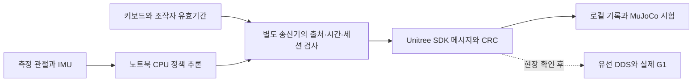

# G1 행사 실행기: 공개 정책을 운영 가능한 동작으로 연결하기

[첫 화면](../README.md) · [G1의 이전 학습·통합 기록](g1.md)

**2026년 10월 · 기존 공개 정책 통합, 키보드 운영, 명령 검증, MuJoCo 시험과 현장 인계 준비**

행사에서는 멋진 동작 하나를 재생하는 것보다 여러 동작을 고르고, 문제가 생기면 멈추고, 사람이 재정비한 뒤 남은 순서를 이어가는 일이 필요했습니다. 보행·춤 정책마다 관측값과 관절 순서, 기준 자세, 출력 배율, PD 게인이 달라서 모델 파일을 모으는 것만으로는 실행할 수 없었습니다.

저는 시연 범위와 조작 방식을 정하고 공개 자산을 선택했으며, Codex와 협업해 실행기·검사·문서를 구현했습니다. 사전학습 정책을 새로 학습한 성과와 구분합니다. 이번 작업에서는 실제 로봇에 접속하거나 모터를 구동하지 않았습니다.

## 가져온 것과 추가한 것

| 구분 | 내용 |
|---|---|
| 실행 기반 | RoboJuDo의 정책·로봇 모델·MuJoCo 구조 |
| 동작 자산 | 기존 보행·강남스타일 배포 자산, exptech G1 Moves의 154 관측 배포 정책 9개 |
| 별도 회전 경로 | 공개 Unitree 보행 정책을 이용한 제자리 회전 |
| 인사 | 제로 명령 보행 위에 작성한 손 흔들기·짧은 목례. 별도로 학습한 인사 정책은 아님 |
| 직접 추가한 실행 기능 | 키보드 선택·준비·시작·중단·재시작, 동작 연결, 사람 도움 재준비, 별도 송신기와 명령 검사 |
| 운영 준비 | 환경 분리, 출처·버전 고정, SDK 기록 시험, 현장 확인 도구, 조작 매뉴얼과 검증 기록 |

154와 160은 관절 수가 아니라 정책 관측 차원입니다. 현재 실물 후보는 전신 29관절과 154 관측을 기준으로 준비했습니다. Fence1의 160 관측 버전은 SIM 비교용으로 남기고, 해당 154 배포본이 없는 동작과 BruceLee는 실물 후보에 포함하지 않았습니다. SONIC 전달이나 새 학습에도 의존하지 않습니다.

## 잘못된 가드를 찾고 고친 과정

처음에는 실제 관절의 기계적 위치 범위를 정책의 PD 목표 위치에도 적용했습니다. 이 때문에 원본 정책이 내놓은 정상 목표까지 거부돼 보행·회전·춤이 중단됐습니다. PD 목표 위치는 현재 측정한 관절 위치와 같은 값이 아니라, 게인과 함께 제어에 사용되는 목표값이라는 점을 실행 코드에 제대로 반영하지 못한 문제였습니다.

원본 RoboJuDo의 실제 전송 경로를 읽어 목표 위치 클리핑이 꺼져 있음을 확인했습니다. 이후 측정 관절각 검사는 유지하고 정책 목표값은 원본대로 전달하도록 분리했습니다. 관절 순서·관측·배율·기준 자세·게인과 최종 SDK의 q/dq/tau/kp/kd·CRC를 대조했습니다. 임의의 출력 자르기나 새로운 힘 제한을 넣어 통과시키지 않았습니다.

이와 함께 모델 준비 후 오래된 센서값을 처리하다 실행기가 종료되는 문제, 지연 뒤 밀린 추론을 몰아서 처리하는 문제, 송신기 초기화 도중 들어온 정지 요청이 사라지는 경쟁 조건을 회귀 테스트와 독립 검토로 수정했습니다. 장시간 시험에서는 화면 처리 지연이 센서 전달까지 늦추는 경로도 찾아, 최신 센서값을 화면과 독립적으로 추론기에 전달하고 조작자 유효기간은 실제 화면 진행 때만 갱신하도록 분리했습니다.

## 중단 뒤 어떻게 이어가는가

평상시에는 동작 선택 → 준비 완료 확인 → 시작 순서로 조작합니다. 다른 동작으로 바꿀 때에는 정지 절차와 준비 자세를 거칩니다. 모든 동작 사이의 즉시 직접 전환을 목표로 삼지는 않았습니다. 강남스타일 중간 재시작 시험에서는 중립 자세가 아직 흔들리는데 준비 완료가 표시되는 문제를 찾아, 기존 측정 안정 조건을 연속으로 만족해야 다음 시작을 허용하도록 수정했습니다.

보호 중단 후에는 사람이 로봇을 일으켜 지지하고, 새 F 입력으로 현재 측정 자세부터 준비합니다. 제로 명령 보행 피드백과 지지 해제 확인을 거친 뒤 다시 동작을 선택합니다. 자동 일어나기나 임의 자세의 자동 균형 회복 기능으로 설명하지 않습니다. 손가락은 제어하지 않으며, 실제 부착 손·더미의 종류와 질량 확인은 별도입니다.

센서·추론 출처·조작자 확인에는 100ms 유효기간을 유지합니다. 오래된 입력은 보호 중단으로 처리하고 자동 재시작하지 않습니다. 별도 송신 프로세스도 컴퓨터·네트워크·네이티브 호출 전체의 고장을 해결하는 하드웨어 비상정지 장치는 아닙니다.

## 검증 결과와 한계

2026-10-17 오프라인 검증 결과입니다. 배포 설정을 적용한 최종 검사이며, 실물·사람 확인은 별도입니다. [공개 가능한 집계 기록](../evidence/g1/event-runtime-20261017.json)에 시험 조건과 동작별 결과를 남겼습니다.

| 검사 | 확인한 결과와 범위 |
|---|---|
| 전체 소프트웨어 검사 | 244/244 통과(이식 포장 보완 포함) |
| 실제 제어기→가드→SDK 기록→MuJoCo | 전체 모션·보행·회전·반복 복구 15경로 완료. 원본 기준의 낙상 조건과 별도 진단 결과를 구분 |
| 동작 전환 | 13개 동작의 초반·중간·끝에서 재시작→정지→다른 동작 전환 39/39 통과 |
| 실제 GUI·추론·별도 송신기 | 모든 동작을 미리 불러오고 180초 실행. 독립 합성 센서를 사용한 시간 검사이며 물리적 균형 시험은 아님 |
| 명령의 센서 출처 나이 | 위 180초 시험에서 p99 43.05ms, 최대 59.91ms. 100ms 검사 유지 |
| 화면 지연 주입 | 센서가 정상인 상태에서 화면을 150ms 지연시키자 조작자 유효기간 만료로 보호 중단·감쇠 기록 |
| 시작·복구 | 모든 동작을 불러온 상태에서 CPU 부하를 준 3회 시작 검사 통과 |

180초 시험의 센서·추론·송신 경로는 최종 실행 경로와 같고, 뒤에 추가한 준비 안정 조건은 전환·시작 검사로 확인했습니다. 2ms 송신 주기와 20ms 정책 주기는 요청값이며 운영체제의 하드 실시간 보장이 아닙니다.

실패도 보존했습니다. Modern은 실제 중력 기준으로 약 0.84rad(48도)까지 기울어져 기존 0.7rad 조기 진단선에 걸렸습니다. 이 결과와 기존 원본 시험의 1rad·높이 0.35m 기준에서 전체 동작을 완료한 결과를 구분하고, 긴 연속 시험에서 메모리 정리로 시간 초과가 생긴 기록을 원인과 함께 남깁니다. 시험 도구의 문제를 수정한 것과 실제 로봇의 안전성을 입증한 것은 다릅니다.

현재 결과는 노트북에서의 소프트웨어·시뮬레이션 준비입니다. 실제 G1의 기체 구성·부착물·바닥·마찰·유선 통신·제어권·독립 정지와 동작별 성공은 현장 확인이 필요합니다. 사람의 키보드 리허설 결과와 실물 성공을 자동 시험 결과로 대신 작성하지 않습니다.

## 다른 사람·PC로 넘기기

현장 운영 순서와 다른 AI용 인계 문서를 별도로 작성하고, 소스·정책·설정은 Git의 상대 경로로 보존했습니다. 새 PC에서는 고정 버전과 해시 잠금 파일로 전용 환경을 다시 만들고 그 머신에서 검사·동결해야 합니다. 기존 노트북의 가상환경이나 절대 경로 검사 영수증을 복사해 합격으로 쓰지 않습니다.

리모컨 기본 모드·개발 모드·노트북 프로그램 상태를 구분한 초보자 안내도 작성했습니다. 펌웨어에 따라 다른 버튼 조합을 보편적인 정지·복귀로 단정하지 않고, 무선 SSH 점검과 유선 정책 제어를 구분했습니다. 실제 기체의 리모컨·복귀 응답은 현장 확인 사항입니다.

새 clone에서 과거 로컬 백업이 없으면 동결 자체가 실패하던 포장 오류도 수정했습니다. 명시적으로 백업 부재를 기록하는 경로를 추가했으며, 백업이 있으면 원본 해시를 검사하고 손상·누락을 계속 거부합니다. 실제 로봇의 제어기·가드·정책 출력은 이 이식 보완에서 변경하지 않았습니다. 외부 패키지 다운로드와 새 머신 검증은 여전히 필요하며, 모든 OS용 사전 빌드나 완전한 오프라인 배포본을 제공한다고 주장하지 않습니다.

## 공개 범위와 원본

공개판에는 사례·구조·수정 이유·검증 요약을 싣습니다. 팀 원본 코드·정책 가중치·내부 현장 정보·원시 로그는 복제하지 않습니다. 재현용 소스와 상세 기록은 개인 비공개 보관본에서 출처와 원본 버전을 함께 유지합니다.

- [RoboJuDo](https://github.com/HansZ8/RoboJuDo/tree/70144b3ca9e1707d1cfeb2b80104c9b86bbde945): 기반과 공개 정책. 저장소 LICENSE CC BY 4.0.
- [exptech/g1-moves](https://huggingface.co/datasets/exptech/g1-moves/tree/895d064b2385725e6aabf540461c219afc3e0916): 공개 모션·정책 자산. CC BY 4.0.
- [Unitree SDK2 Python](https://github.com/unitreerobotics/unitree_sdk2_python/tree/37116c521f1588482e238d8450e471ba78ab9863): G1 저수준 메시지·CRC·통신 인터페이스. BSD-3-Clause.

기존 보행·강남 자산은 별도의 로컬 배포 자산이며 위 공개 저장소에서 새로 학습한 결과가 아닙니다. 해당 파일은 이 공개 포트폴리오에 포함하지 않습니다. [전체 출처·공개 범위](../docs/SOURCE_AND_SCOPE.md)
