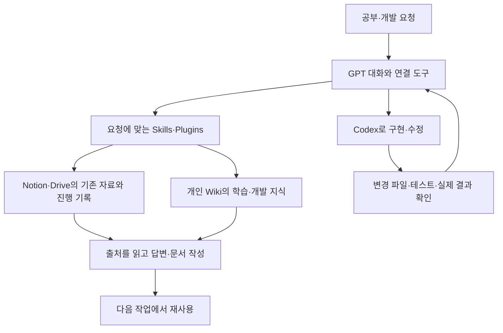

# Personal AI 개발

[첫 화면](../README.md) · [Codex 개발 과정](agentic-development.md)

**2026년 9–10월 · 사용 경로와 요구 설계, Codex 작업 지시·검토·통합, Skills·Plugins 개발**

공부와 개발을 할 때 자료를 다시 찾거나, 대화가 바뀌면 같은 맥락을 처음부터 설명해야 했습니다. 이 반복을 줄이려고 Personal AI를 만들기 시작했습니다. NotebookLM으로 자료를 정리하고, GPT와 연결 도구로 필요한 자료를 읽으며, Codex로 개발하는 경로를 정했습니다. 학습 글은 개인 Wiki에 보관하고 학업 절차는 Skills로 정리했습니다.

한 달여 동안 Codex에 구현을 맡기고 코드를 실행하며 에이전트 코딩을 익혔습니다. 설치된 기능이 호출되지 않거나, 테스트 통과 보고와 실제 변경이 달라 다시 고친 경우도 있었습니다. 파일과 실행 결과를 읽고 수정 범위를 좁혀 다시 지시했습니다. 사용하기 번거롭거나 원본을 잘못 다루는 기능도 이 과정에서 고쳤습니다.

## 구성과 사용 방식



Notion·Drive·GitHub·Wiki는 각 서비스에 연결된 도구로 읽고, 코드 실행은 로컬 환경에서 진행합니다. NotebookLM 자료는 기존에 내보낸 결과를 사용합니다. 서비스별 도구를 호출하는 방식이며, 단일 서버의 자동 실행이나 화면 간 자동 동기화는 구현하지 않았습니다.

| 구성 | 맡은 작업 | 소스와 실행 기록 |
|---|---|---|
| GPT와 연결 도구 | 질문별 원본 위치, 사용할 도구와 다음 작업 경로 | 자료를 읽고 기존 결과를 이어 쓰는 흐름 |
| Codex | 요구·수정 범위·완료 조건, 실행·검토·통합 절차 | 실제 소스와 변경·테스트 기록 |
| 세컨드 브레인 | 원자료와 재사용할 글을 구분하고 필요한 글만 조회 | 기존 푸리에 학습 글 재조회 |
| Academic Loop | 수업·복습·과제·시험을 네 Skill로 나누고 공통 지침 연결 | 실제 패키지, 구조 검사, 제한된 실행 사례 |
| Discovery Dam | 기존 조사 재사용, 출처 보존, 조사 도구 선택과 결과 정리 | 패키지·Skill·참조 문서와 후보 정리 스크립트 |

## 학습 기록을 다시 찾은 사례

2026년 10월 4일, 개인 Wiki에서 푸리에 계수 계산에 관한 이전 글을 찾았습니다. **구간·주기와 짝홀성을 확인하고, 계수 적분을 하나 직접 계산하거나 직교성으로 공식을 점검한다**는 내용을 답변에 활용했습니다. 기존 Wiki에서 필요한 글만 조회했습니다.

[학습 기록 조회 발췌](../evidence/personal-ai/academic-reuse.json)에서 당시 결과를 볼 수 있습니다. 개인 경로는 제거했으며, 학습 효과는 측정하지 않았습니다.

## Academic Loop와 Discovery Dam

[Academic Loop](../code/personal-ai/academic-loop/README.md)는 수업 준비와 자료 처리, 공부, 과제, 시험을 네 Skill로 나눈 플러그인입니다. 짧은 복습 질문에도 긴 수업 절차가 실행되거나, 설명만 하고 학습 완료로 기록하는 문제를 고쳤습니다. 질문에 맞춰 직접 답변·힌트·풀이·대화식 복습을 선택하고, 학습자의 답을 확인한 뒤 상태를 기록하도록 지침을 작성했습니다.

Notion의 수업 기록, Drive 원본과 Wiki의 관련 글을 찾아 쓰도록 구성했습니다. 자료와 권한, 학습 상태에 관한 공통 규칙은 참조 문서로 모았습니다. 공개한 패키지는 개발 원본 0.1.3의 사본입니다.

10월 4일에는 0.1.1 원본과 설치본의 파일 15개를 대조하고 구조 검사 12항목을 통과했습니다. 앞의 Wiki 조회를 제외한 네 시나리오는 합성 입력으로 검사했고, NotebookLM은 실행하지 않았습니다. [당시 검증 요약](../evidence/personal-ai/academic-reuse.json)에는 설치 검사와 Wiki 조회를 따로 담았습니다.

Discovery Dam은 이전 조사와 원자료를 먼저 찾고, 질문에 맞는 조사 도구를 고른 뒤 결과와 출처를 보관하도록 만든 Skill입니다. URL 정규화와 중복·변경 구분, 기준 버전과 피드백 범위 검사는 Python 코드로 처리합니다. [후보 정리 코드와 테스트](../code/personal-ai/discovery-dam/README.md)에서 이 부분을 볼 수 있습니다.

## 한 달간의 개발 기록

| 시기 | 실제로 다룬 문제와 수정 |
|---|---|
| 9월 초부터 | 학업·개발에서 필요한 사용 장면과 자료 경로를 정하고, 원본 서비스와 별도 상태가 어긋나는 문제를 검토 |
| 9/15 | 긴 대화 없이도 작업을 이어갈 수 있는지 짧은 문맥으로 시험. 최신 상태 질문에는 실제 연결 도구가 필요하다는 점 확인 |
| 9/17–19 | 기존 과제의 마감만 바꾸는 시험과 코딩 도구 비교. 원본 보존·권한·사용 부담을 보고 일부 자동 쓰기 경로 중단 |
| 9/20 | Windows Wiki hook의 JSON·인코딩·실행 경로 오류 추적, Skill을 쓰는 경우와 직접 지시하는 경우 비교 |
| 9월 말 | 테스트가 통과해도 실제 변경이 없거나 자료를 잘못 조회하는 사례를 다시 검토하고, 실패 기록과 재시험 분리 |
| 10월 초 | Academic Loop·Discovery Dam 패키지 개발과 검사, 학업 기록 재사용, 실제 문서·교육·포트폴리오 준비에 AI 도구 활용 |

초기에는 별도의 실행·관리 계층을 실험했습니다. 설정과 복구에 드는 일이 많아 GPT와 Codex의 기존 기능을 중심으로 정리했습니다. 지금 사용하는 구성과 당시 시험한 코드는 따로 보관하고 있습니다.

## 코드와 실행 예제

**Codex Runner 원본 함수:** [PowerShell 함수 다섯 개](../code/personal-ai/examples/README.md)는 작업 지시의 `TASK`·`DONE_WHEN`을 읽고, 허용한 저장소 경로를 찾으며, 외부 명령의 종료 코드를 확인합니다. 개인 경로와 계정 쓰기 부분은 제외했습니다. Windows의 stderr 출력과 실패 후 상태 복원도 로컬 검사로 확인할 수 있습니다.

**결과 보고서 판정기:** [JavaScript 모듈](../code/personal-ai/src/lived-canary-evidence.js)은 합성 입력의 필수 조건, 부작용 지표, 보고 결과가 맞는지 대조합니다. 문제를 기록한 `FAIL`과 문제를 숨긴 `PASS`를 구분하며, 외부 원본 재조회가 없는 실사용 표시 입력은 `INVALID`로 거절합니다. 공개 CLI는 Provider에 접속하지 않습니다.

```sh
# 저장소 루트
node scripts/check-evidence.mjs
node code/personal-ai/scripts/validate-lived-canary-evidence.mjs code/personal-ai/fixtures/github-pass.synthetic.json
```

## 개발 중 겪은 오류

Windows 실행 오류와 Skill 호출 문제, 수정 후 재시험 과정은 [Codex 개발 기록](agentic-development.md)에 적었습니다.
