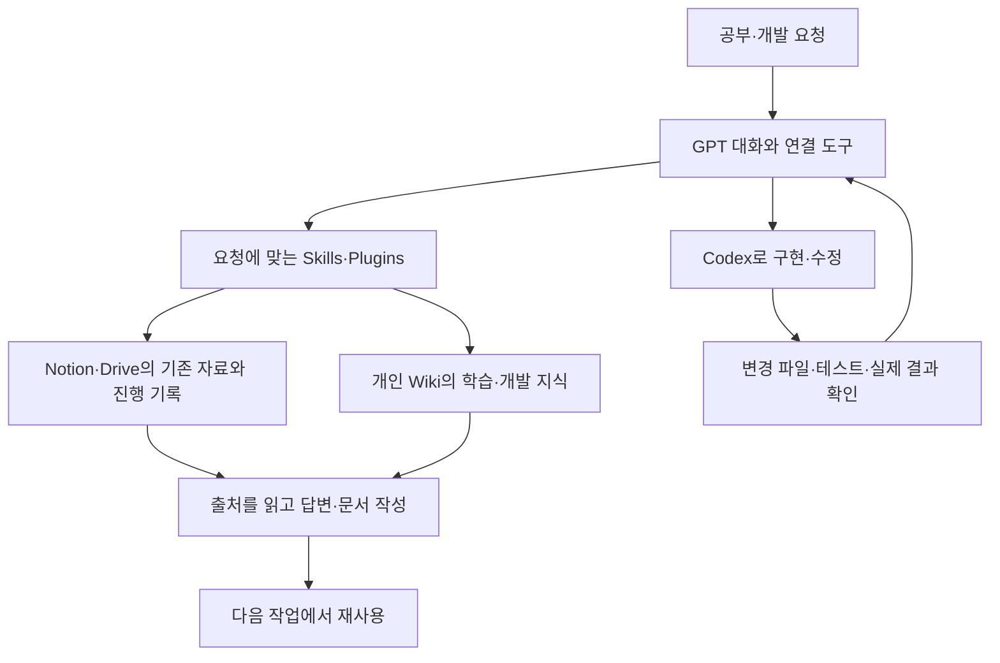

# Personal AI · 공부와 개발을 이어 쓰기 위한 개인 AI

[첫 화면](../README.md) · [Codex 개발 과정](agentic-development.md)

**2026년 9–10월 · 사용 경로와 요구 설계, Codex 작업 지시·검토·통합, Skills·Plugins 개발**

공부와 개발을 할 때마다 자료를 다시 찾고, 새 대화에서 같은 맥락을 설명하는 일이 반복됐습니다. 이전 학습과 작업 기록을 다음 질문에 활용하고 싶어 Personal AI를 만들기 시작했습니다. NotebookLM의 자료 정리 흐름부터 GPT의 대화와 연결 도구, Codex의 개발 환경, 세컨드 브레인과 학업용 Skills까지 사용 경로를 정하고 연결했습니다.

한 달여 동안 기능을 붙이고 시험한 뒤, 실제로 쓰기 번거롭거나 원본을 잘못 다루는 부분을 다시 고쳤습니다. 에이전트 코딩도 이 과정에서 익혔습니다. 처음부터 구현 방법을 모두 알고 시작한 것은 아니었고, Codex에 요구를 설명한 뒤 파일과 실행 결과를 확인하며 필요한 수정과 다음 작업을 정했습니다.

## 기존 구성과 사용하는 흐름



**기존 구성 설명도입니다.** 한 서버가 모든 일을 자동 실행하는 구조를 뜻하지 않습니다. Notion·Drive·GitHub·Wiki의 자료와 로컬 실행은 각각 접근 가능한 도구로 읽습니다. NotebookLM 결과도 기존에 내보낸 자료를 연결해 쓰며, 자동 생성이나 모든 화면 간 동기화가 검증된 것은 아닙니다.

| 구성 | 제가 정리·개발한 부분 | 실제로 확인한 범위 |
|---|---|---|
| GPT와 연결 도구 | 질문별 원본 위치, 사용할 도구와 다음 작업 경로 | 자료를 읽고 기존 결과를 이어 쓰는 흐름 |
| Codex | 요구·수정 범위·완료 조건, 실행·검토·통합 절차 | 실제 소스와 변경·테스트 기록 |
| 세컨드 브레인 | 원자료와 재사용할 글을 구분하고 필요한 글만 조회 | 기존 푸리에 학습 글 재조회 |
| Academic Loop | 수업·복습·과제·시험을 네 Skill로 나누고 공통 지침 연결 | 실제 패키지, 구조 검사, 제한된 실행 사례 |
| Discovery Dam | 기존 조사 재사용, 출처 보존, 조사 도구 선택과 결과 정리 | 패키지·Skill·참조 문서와 후보 정리 스크립트 |

## 학습 기록을 다시 찾은 사례

2026년 10월 4일 실행 기록에서는 기존 개인 Wiki를 찾아 푸리에 계수를 계산할 때 주의할 내용을 읽었습니다. 계산 전에 **구간·주기와 짝홀성을 확인하고, 계수 적분을 하나 직접 계산하거나 직교성으로 공식을 점검한다**는 기존 글을 답변에 활용했습니다. 새 Wiki를 만들거나 전체 자료를 다시 색인하지 않고 필요한 글을 조회했습니다.

**이전 학습 기록을 조회하고 답변에 다시 활용한 사례**입니다. 학습 효과는 측정하지 않았습니다. [개인 경로를 제거한 실행 발췌](../evidence/personal-ai/academic-reuse.json)를 함께 제공합니다.

## 학업 절차를 실제 Skill 패키지로 만들기

[Academic Loop](../code/personal-ai/academic-loop/README.md)는 수업 전후 자료 처리, 공부, 과제, 시험 준비를 분리한 플러그인입니다. 복습 질문에 답하는데 매번 전체 수업 절차를 실행하거나, 설명만 제공하고 학습 완료로 기록하는 문제를 줄이도록 내용을 고쳤습니다. 직접 답변·힌트·풀이·대화식 복습을 구분하고, 실제 답을 확인하기 전에는 학습 상태를 올리지 않도록 작성했습니다.

기존 Notion의 수업 기록과 Drive 원본, Wiki의 관련 글을 찾아 쓰도록 연결했습니다. 공통 규칙은 참조 문서로 분리해 네 Skill이 같은 자료·권한·학습 기준을 따르도록 했습니다. 공개한 파일은 **현재 개발 원본 0.1.3의 패키지 사본**입니다.

10월 4일의 0.1.1 검증 기록에는 원본과 설치본 15개 파일 일치, 구조 검사 12항목 통과가 남아 있습니다. 이 설치 검사와 앞의 Wiki 조회는 서로 다른 근거입니다. 당시 나머지 네 시나리오는 합성 입력이었고 NotebookLM 실행은 하지 않았습니다. [당시 검증 요약](../evidence/personal-ai/academic-reuse.json).

Discovery Dam도 개인 조사 방식에 맞춰 만들었습니다. 이전 조사와 원자료를 먼저 찾고, 질문에 맞는 조사 도구를 선택한 뒤 결과와 출처를 보존하는 Skill입니다. 공개 원자료 후보를 다루는 코드에는 URL 정규화, 중복·변경 구분, 기준 버전 검사와 피드백 범위 처리가 있습니다. [실제 후보 정리 코드와 기존 테스트](../code/personal-ai/discovery-dam/README.md)를 함께 공개합니다. 조사 도구를 고르는 절차는 Skill에, URL과 중복 처리는 코드에 나누어 담았습니다.

## 한 달 동안 바뀐 개발 방식

| 시기 | 실제로 다룬 문제와 수정 |
|---|---|
| 9월 초부터 | 학업·개발에서 필요한 사용 장면과 자료 경로를 정하고, 원본 서비스와 별도 상태가 어긋나는 문제를 검토 |
| 9/15 | 긴 대화 없이도 작업을 이어갈 수 있는지 짧은 문맥으로 시험. 최신 상태 질문에는 실제 연결 도구가 필요하다는 점 확인 |
| 9/17–19 | 기존 과제의 마감만 바꾸는 시험과 코딩 도구 비교. 원본 보존·권한·사용 부담을 보고 일부 자동 쓰기 경로 중단 |
| 9/20 | Windows Wiki hook의 JSON·인코딩·실행 경로 오류 추적, Skill을 쓰는 경우와 직접 지시하는 경우 비교 |
| 9월 말 | 테스트가 통과해도 실제 변경이 없거나 자료를 잘못 조회하는 사례를 다시 검토하고, 실패 기록과 재시험 분리 |
| 10월 초 | Academic Loop·Discovery Dam 패키지 개발과 검사, 학업 기록 재사용, 실제 문서·교육·포트폴리오 준비에 AI 도구 활용 |

초기에는 자체 실행·관리 계층도 실험했습니다. 그러나 설정과 복구를 계속 챙겨야 하는 부담이 남아, GPT와 Codex의 기존 기능을 중심으로 정리했습니다. 현재 사용하는 구성과 당시 시험한 코드는 구분해 보관했습니다.

## 공개 코드로 볼 수 있는 개발 흔적

**Codex Runner 원본 함수:** [PowerShell 함수 다섯 개](../code/personal-ai/examples/README.md)는 작업 지시의 `TASK`·`DONE_WHEN`을 읽고, 허용한 저장소 경로를 찾으며, 외부 명령의 종료 코드를 확인합니다. 개인 경로와 계정 쓰기 부분은 제외했습니다. Windows의 stderr 출력과 실패 후 상태 복원도 로컬 검사로 확인할 수 있습니다.

**결과 보고서 판정기:** [JavaScript 모듈](../code/personal-ai/src/lived-canary-evidence.js)은 합성 입력의 필수 조건, 부작용 지표, 보고 결과가 맞는지 대조합니다. 문제를 기록한 `FAIL`과 문제를 숨긴 `PASS`를 구분하며, 외부 원본 재조회가 없는 실사용 표시 입력은 `INVALID`로 거절합니다. 공개 CLI는 Provider에 접속하지 않습니다.

```sh
# 저장소 루트
node scripts/check-evidence.mjs
node code/personal-ai/scripts/validate-lived-canary-evidence.mjs code/personal-ai/fixtures/github-pass.synthetic.json
```

## 제 역할

사용 장면, 자료를 찾는 경로, 도구와 Skill의 역할, 무엇을 확인해야 사용할 수 있는지를 정했습니다. 구현과 초안은 Codex 등 AI의 도움을 받았고, 결과를 읽고 수정 요청·시험·통합을 이어갔습니다. 학업용 패키지와 포트폴리오도 이 방식으로 준비했습니다. [시행착오와 실제 파일별 근거](agentic-development.md)에는 구현 과정에서 확인한 오류와 검토 방법을 더 자세히 적었습니다.
