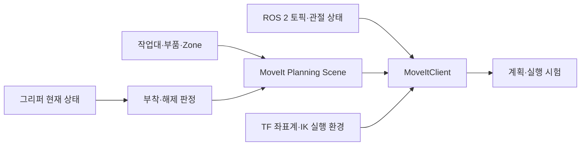

# Humanoid Challenge 개발 기록

[첫 화면](../README.md) · [환경·인터페이스·시험 근거](../code/robotics/ENVIRONMENT_AND_TEST_EVIDENCE.md)

**2026년 5–6월 · ROBOTIS AI Worker, ROS 2 Jazzy, MoveIt 2, RViz, Python, Docker, TF, TRAC-IK**

이 과제에서 맡은 일은 로봇이 보고 있는 물체 상태와 MoveIt 2의 Planning Scene을 일치시키는 것이었습니다. 작업대·부품의 충돌 객체와 그리퍼의 부착·해제 상태를 연결하는 과정에서 누락된 부착 명령, IK 플러그인 로드 실패, 로봇이 움직일 때 책상도 따라 움직이는 좌표계 문제를 확인했습니다. 수정 과정과 시험 결과는 5~6월 개발일지에 남아 있습니다.

## 작업 흐름



## 5월 22일 · 닫힌 그리퍼의 부착 누락

기존 노드는 그리퍼가 열림에서 닫힘으로 바뀌는 순간에만 attach를 요청했습니다. 따라서 그리퍼를 이미 닫은 채 물체로 접근하면 새로운 닫힘 이벤트가 없어서 부착 명령을 놓칠 수 있었습니다. 이를 보완하려고 최근접 물체와 현재 그리퍼 상태를 주기적으로 확인하고, 같은 요청이 이미 대기열에 있으면 다시 추가하지 않도록 수정했습니다.

```python
# 원본 변경의 동작을 설명하는 의사코드
if nearby_object and gripper_closed:
    if not attach_request_pending:
        enqueue_attach_request()
```

| 당시 변경 | 값과 근거 |
|---|---|
| 닫힘·열림 임계값 | `0.50→0.35`, `0.40→0.25`. 시뮬레이션 그리퍼 관측 최고값 약 0.41 |
| Zone A/C의 부착 후보 거리 | 각각 `0.08→0.15 m`, `0.12→0.15 m`. 관측한 EEF–부품 거리 약 0.10 m |
| 데모 초기화 | `spin_once(timeout_sec=0.05)`를 최대 20회 호출해 초기 joint-state callback 처리 |

개인 커밋 `8fc3c96f12d41f6593e6cf514de36c2852e58dd3`의 `tests/competition_manager_node.py`, `demo_0519.py`, `demo_grasp.py`에 남은 변경입니다. 값은 시뮬레이션 장면의 부착 판정 임계값입니다. 기반 팀 코드와 AI 구현 지원을 활용해 수정·검토했습니다.

## 5월 25일 · 작업 환경을 충돌 장면으로 구성

RViz marker는 화면 표시이고 CollisionObject는 경로계획에 사용하는 환경입니다. `environment.py` 작업본에서는 Zone A–D의 작업대·다리·상자·부품을 box/cylinder로 등록하고 제거하는 경로를 다뤘습니다. 구역이 바뀔 때 이전 객체를 정리하고 새 객체를 넣으며, 집거나 놓을 때 attach/detach 상태를 갱신하는 구조입니다.

좌우 팔에서 같은 전역 Planning Scene에 add/remove를 보내면 갱신 순서가 엇갈릴 수 있어 환경 등록을 한 publisher로 모았습니다. 이후 개발일지에는 작업본의 `client.moveit2_r`와 실제 인터페이스의 `_moveit_r`가 맞지 않는 오류도 기록돼 있습니다. 이 버전 조합에서 정상 실행됐는지는 확인되지 않았습니다.

## 6월 2일 · IK 의존성과 작업공간 시험

처음 팔 계획 시험은 47회 모두 실패했습니다. 설정 파일에는 TRAC-IK가 지정돼 있었지만 컨테이너 로그에는 `trac_ik_kinematics_plugin failed to load`가 있었습니다. 플러그인을 설치하고 계획 프로세스를 재시작한 뒤 같은 기록은 42/47로 바뀌었습니다.

| 당시 mock hardware / 계획 시험 | 기록 |
|---|---:|
| 연결·FK·입력 검사 `test_moveit_client` | 12/12 |
| 팔 계획 `test_arm_motion` | 복구 전 0/47 → 복구 후 42/47 |
| 경계 포즈 `test_workspace_d` | 1차 35/53, 확장 53/84 |

위치와 pitch를 함께 바꾸며 제한 조건을 살펴보고 `is_pose_safe()` 초안을 다뤘습니다. 예를 들어 x=0.150 m, pitch 약 20°는 당시 환경에서 관찰한 조건입니다. 계획 프로세스 시작 전에 데모를 켜 `robot_description`을 찾지 못한 실행 순서 문제도 확인했습니다.

## 6월 3일 · 팀 모듈의 인터페이스 맞추기

| 항목 | 변경·점검 |
|---|---|
| 활성 작업 토픽 | `/active_zone` → `/active_mission` |
| 노드 이름 | `competition_manager` → `manipulator_state` |
| 노드 생성 | `MoveItClient(node)`와 초기화·수명주기 |
| 작업대 | `config/desk.yaml`, `setup_desk/remove_desk` |

System 팀 변경에 맞춰 환경·그리퍼·행동 모듈의 토픽과 이름, 인자·상태를 수정했습니다.

## 6월 25일 · 이동하는 로봇과 고정된 책상

환경 객체를 `base_link` 기준에만 두면 로봇 이동에 따라 책상과 장애물도 움직이는 것처럼 표현됩니다. `planning_scene.py` 작업본에서는 `odom←base_link` TF로 물체 좌표를 변환해 고정 좌표계에 배치하려 했습니다. 미커밋 작업본이며 이동 후 실물 검증과 팀 main 반영은 확인되지 않았습니다. TF 조회 실패 시 base 좌표를 그대로 쓰는 fallback도 추가 확인할 부분입니다.

## 팀 실물 시험

소프트웨어 경로계획 시험과 별개로, 팀원들과 AI Worker 실물에서 물체를 집고 너트를 다른 위치까지 옮기는 작업도 시험했습니다. 다만 목표 위치에 내려놓는 placement는 완료하지 못했으며, 위의 mock 시험 통과 건수를 실물 성공률로 제시하지 않습니다.

그리퍼·초기화 수정과 충돌 환경·인터페이스 통합, IK·TF 오류 분석을 맡았고 팀 실물 시험에 참여했습니다. 구현에는 AI의 도움을 받았으며 기반 로봇과 프레임워크는 팀 자산입니다. 팀 소스·patch 원문 대신 [기술 설명과 시험 기록](../code/robotics/ENVIRONMENT_AND_TEST_EVIDENCE.md)을 공개했습니다. 사진과 실행 화면은 Notion 포트폴리오에서 볼 수 있습니다.
